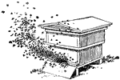

# beeswax

*Mind your own Beeswax!*

A terminal-based personal information manager inspired by [Lotus Agenda](https://en.wikipedia.org/wiki/Lotus_Agenda). It is strongly recommended that you consult the resources at Bob Newell's [Lotus Agenda Wiki](https://agenda.bobnewell.net/) to learn more. [Beeswax](https://waxandwane.org/beeswax/) organizes items into views and categories and stores everything in a single `.bwx` file that can optionally be AES-256-GCM encrypted.

There's still a huge amount of work to do, but I am now using Beeswax at both home (Linux) and the office (Windows) to do real work. I've put it here mostly so that it's easier to get on to my office laptop.

## Features

- **Items** — items live in a global pool and are assigned to one or more categories
- **Views, sections, columns** — views present filtered, sorted slices of that data in named sections; columns present additional category assignments.
- **Category Manager** — hierarchical category tree with rename, create, delete, reorder
- **View Manager** — switch view, rename, create, delete
- **Notes** — per-item notes opened in `$EDITOR` (defaults to `notepad.exe` on Windows)
- **Search** — `/` searches forward, `?` searches backward; matches both item text and section heads; `n`/`N` repeat in same/opposite direction with wrap-around
- **Undo / Redo** — session-length undo / redo
- **Encryption** — optional AES-256-GCM file encryption with Argon2id key derivation
- **Color schemes** — eight built-in themes plus a fully custom, editable, hex-color scheme

## Installation

### Download a binary

Pre-compiled binaries for Linux (x86\_64, static), macOS (x86\_64 and Apple Silicon), and Windows (x86\_64) are attached to each [nightly release](../../releases/tag/nightly).

### Build from source

Requires Rust 1.85 or later (edition 2024).

```sh
git clone https://github.com/rpmohn/beeswax.git
cd beeswax
cargo build --release
# binary at target/release/beeswax
```

Or install directly into `~/.cargo/bin`:

```sh
cargo install --git https://github.com/rpmohn/beeswax.git
```

## Usage

```sh
beeswax notes.bwx              # open or create a plain file
beeswax --encrypt secrets.bwx  # open or create an encrypted file
```

When opening an encrypted file beeswax prompts for the password before entering the TUI. When creating one with `--encrypt` it prompts for a new password and confirmation.

## Key Reference

Navigation is vi-style throughout: `hjkl` movement, `i`/`o`/`O` to start
editing, and `/` to search. Arrow keys, Home/End/PgUp/PgDn and all F-keys work
everywhere as well, so nothing requires the vi bindings.

The modifiers divide up as follows. Unprefixed keys are vi verbs and motions
acting on the item under the cursor. **Shift** gives the reverse or the larger
version of the unshifted key. **Ctrl** is for whole-file and whole-view
commands, and for moving a piece of structure: a column across the view, a
category through the tree. **Alt** adds structure around the items — a section
or a column. Structural editing follows VimOutliner, which leaves it
to plain vim: `o`/`O` to make a sibling, `>>`/`<<` to change its level.

[KEYS.pdf](KEYS.pdf) is the same material condensed onto one printable page.
It is built from [KEYS.tex](KEYS.tex) with `pdflatex KEYS.tex`.

### View screen — moving around

| Key | Action |
|-----|--------|
| ↑ / ↓ or k / j | Move up / down |
| ← / → or h / l or Tab / Shift+Tab | Move left / right across columns |
| Enter / Shift+Enter | Move down / up |
| PgDn / PgUp or Ctrl+F / Ctrl+B | Move down / up one screenful |
| Home / End or { / } | Current section head / last item in section (press again for the previous / next section) |
| Shift+Home / Shift+End | Head of the previous / next section |
| Ctrl+Home / Ctrl+End or gg / G | Very top / bottom of the view |
| H / M / L | First / middle / last visible row on screen |
| zz | Re-center scroll so the cursor is in the middle |
| z Enter / z- | Scroll so the cursor is at the top / bottom |
| Ctrl+PgUp / Ctrl+PgDn | Cycle to the previous / next view |

### View screen — searching

| Key | Action |
|-----|--------|
| / / ? | Open forward / backward search bar |
| n / N | Repeat last search in the same / opposite direction (wraps) |

### View screen — editing

| Key | Action |
|-----|--------|
| i or F2 | Edit item text or cell value |
| o or Insert | New item below the cursor |
| O | New item above the cursor |
| x or Delete | Main column — remove item from the section's category (on a section head: remove the section). Data column — clear the item's value for that column (on the column head: remove the column) |
| Shift+Delete | Discard item from all categories permanently |
| u or Ctrl+Z | Undo |
| Ctrl+R or Ctrl+Y | Redo |
| F3 | Assign categories (main column) / pick value (data column) |
| F4 | Mark item done |
| F5 | Open note in `$EDITOR` |
| F6 | Item / section / column properties |
| F8 / F9 / F10 | View Manager / Category Manager / Menu |
| Ctrl+S | Save file |
| Alt+Q | Quit |

### Alt commands (View screen)

Bare `o`/`O` create an item; Alt lifts the same verb to the structure holding
the items. Alt plus a direction adds on that side, Ctrl plus a direction moves.

| Key | Action |
|-----|--------|
| Alt+j / Alt+k or Alt+↓ / Alt+↑ | New section below / above |
| Alt+h / Alt+l or Alt+← / Alt+→ | New column to the left / right |
| Ctrl+h / Ctrl+l or Ctrl+← / Ctrl+→ | Move the current column left / right |
| Alt+s | Sort current section now |

All four are quick adds: a category picker opens, and the section or column
appears as soon as you choose a category — no Insert, Width, Position or
Format fields to confirm. Esc backs out without adding anything.

The full forms are on Menu › View › Section › Add and
Menu › View › Column › Add when you want those fields.

### Lists and pickers

Every scrolling list — Category Manager, View Manager, the F3 pickers, Quick
Add, Section Select, and the sort and filter dialogs — takes the same keys:

| Key | Action |
|-----|--------|
| ↑ / ↓ or k / j | Move up / down |
| PgUp / PgDn or Ctrl+B / Ctrl+F | Page up / down |
| Home / End or gg / G | First / last entry |
| H / M / L | Top / middle / bottom of the visible window |
| / | Search within the list |
| i / o / x / u | Rename / create / delete / undo, where the list supports it |
| Enter / Esc | Confirm / cancel |

The category pickers — the quick adds, and F3 on the Section Add form —
manage categories in place: `/` searches (F7 / F8 step through the matches), Insert
adds, F2 renames, Delete discards, and F6 opens category properties. Esc there
closes the picker and returns to the dialog rather than cancelling it. Delete
is refused for a protected category, and for the current section's head
category, since removing it would pull the view out from under the cursor.

## Configuration

Config file location:

| Platform | Path |
|----------|------|
| Linux / macOS | `~/.config/beeswax/config.toml` |
| Windows | `%APPDATA%\beeswax\config.toml` |

The directory is created automatically on first run if it does not exist. All settings are optional; omit any line to keep the default.

```toml
# Color scheme (see below)
colorscheme = "AgendaColor"
```

An annotated example with all options is in [`config.example.toml`](config.example.toml).

### Color schemes

| Name | Description |
|------|-------------|
| `AgendaMono` | Terminal default colors with reverse-video highlights |
| `AgendaColor` | Cyan body, blue bars, red selection — classic Lotus Agenda look |
| `GruvboxDark` | Gruvbox dark — warm cream on charcoal, teal selection |
| `GruvboxLight` | Gruvbox light — dark warm text on cream, teal selection |
| `SolarizedDark` | Solarized dark palette |
| `SolarizedLight` | Solarized light palette |
| `Dracula` | Dracula — purple-gray background, purple selection, cyan sections |
| `Custom` | User-defined hex colors (see below) |

### Custom color scheme

Set `colorscheme = "Custom"` then define any subset of the following in a `[custom_theme]` section. Omitted fields fall back to the Agenda Mono (terminal reverse-video) theme. All values are `"#rrggbb"` hex strings.

The easiest way to build a custom theme is to open F10 → Utilities → Customize, navigate to any built-in scheme, then move into the Color Settings area and edit individual fields — beeswax automatically copies the base theme into Custom on the first edit.

```toml
colorscheme = "Custom"

[custom_theme]
# Title bar, F-key bar, and menu bar
bar_fg              = "#839496"
bar_bg              = "#073642"

# Selected field / edit cursor
selected_item_fg    = "#002b36"
selected_item_bg    = "#839496"

# Selected row in the view body
view_selected_fg    = "#002b36"
view_selected_bg    = "#5e6e73"

# Modal dialog content
dialog_item         = "#839496"   # dialog body text
dialog_bg           = "#073642"   # dialog background
dialog_border_fg    = "#268bd2"
dialog_border_bg    = "#073642"
dialog_label        = "#586e75"   # unselected field label
dialog_label_sel_fg = "#2aa198"   # selected field label

# View body
view_bg             = "#002b36"   # view background
view_item           = "#839496"   # item text
view_col_entry      = "#839496"   # column value text
view_col_head       = "#2aa198"   # column header
view_sec_head       = "#2aa198"   # section header
view_head_bg        = "#002b36"   # section/column header line background
```

## File format

Beeswax files use the `.bwx` extension. The format is a short binary header followed by either plain JSON or AES-256-GCM encrypted JSON:

```
BWX\0  — 4-byte magic
u32 LE — format version
u8     — 0 = plain, 1 = encrypted
[plain JSON]  or  [32-byte salt | 12-byte nonce | ciphertext]
```

Encryption uses Argon2id to derive a 256-bit key from the password and a random salt.

## Screens

### View screen (default)

The main working area. Items are displayed under their section heads. Each view can have additional data columns to the right of the main item text.

### Category Manager (F9)

A hierarchical tree of all categories. Navigation and the shared list keys are
as described under [Lists and pickers](#lists-and-pickers); these are specific
to this screen:

| Key | Action |
|-----|--------|
| Insert or `o` | Create a sibling below the current category |
| `O` | Create a sibling above the current category |
| `>>` or Ctrl+l or Ctrl+→ | Demote one level |
| `<<` or Ctrl+h or Ctrl+← | Promote one level |
| Ctrl+j / Ctrl+k or Ctrl+↓ / Ctrl+↑ | Move the category down / up among its siblings |
| Enter or F2 or `i` | Rename the current category |
| Alt+F10 | Enter move mode |
| Delete or `x` | Delete the current category |
| F6 | Category properties |

There is no "create a child" key: make a sibling with `o` and demote it with
`>>`, as you would in VimOutliner. On a root category `o` and `O` both create a
first child, since a root category cannot have a sibling. Alt+F10 is the only
Alt key on this screen: level and order are Ctrl here, as they are on the View
screen, where Ctrl+direction moves a column.

### View Manager (F8)

Lists all views. Enter switches to the selected view, F2 renames inline, F4
deletes with confirmation, F6 opens the view properties dialog. Insert or
`o` adds a view, and Ctrl+j / Ctrl+k (or Ctrl+↓ / Ctrl+↑) reorder the list.

In View Properties, Ctrl+j / Ctrl+k (or Ctrl+↓ / Ctrl+↑) reorder the Sections
list while that field is active. Reordering is Ctrl on every screen that has
it, matching the Category Manager.

**View Properties (F6) — Section Select**

Press F3 on the Sections field to open the Section Select picker. Space cycles each category through inclusion states:

| Marker | Meaning |
|--------|---------|
| (space) | Not included |
| `*` | Included as a section (manual) |
| `S` | Subs — all descendant categories are automatically added as sections; updates whenever subcategories are added or removed |
| `A` | All — same as Subs, but also includes the category itself |

`S` and `A` are only available for categories that have subcategories. Categories governed by a parent `S`/`A` rule are shown with `*` and cannot be toggled independently.

### Customize (F10 → Utilities → Customize)

Live color editor. Navigate with arrow keys or hjkl. On any color field, press F2 or type a hex character to begin editing, Space to reset to terminal default. Selecting a built-in theme and then editing a color automatically switches to the Custom scheme with all other colors pre-filled from the chosen theme.

## License

MIT — see [LICENSE](LICENSE).
